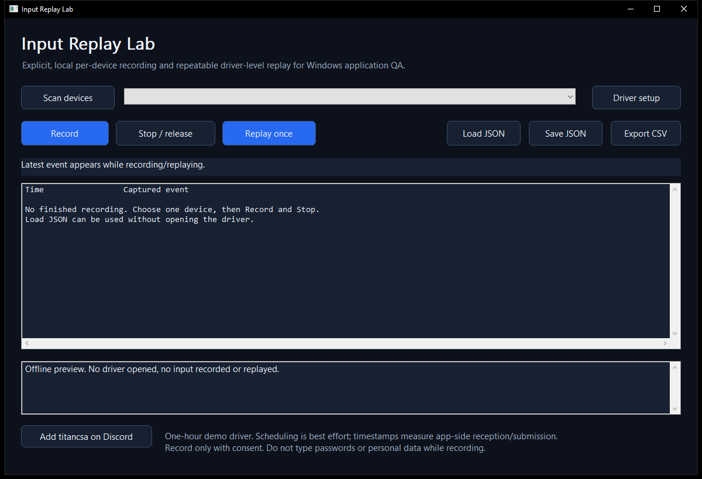

# Input Replay Lab

**Record one selected keyboard or mouse, inspect its event timeline, and replay it through the driver** for repeatable Windows application QA. Native C++17 interface powered by [Interceptor Keyboard & Mouse](https://github.com/TitanCSA/Interceptor-Keyboard-Mouse).

<!-- full-version-contact:start -->
> [!IMPORTANT]
> **Get the full driver version without demo restrictions**
>
> **Discord username: `titancsa`**
>
> Open Discord, choose **Friends > Add Friend**, enter **`titancsa`**, then send a direct message. Ask for the **full driver version without the demo time limit**, and mention **Input Replay Lab**.
>
> The demo limit belongs to **Interceptor Keyboard & Mouse**, the driver used by this project. Ask for pricing and the appropriate license / activation instructions; the application or wrapper source keeps its existing license.
<!-- full-version-contact:end -->



**[Download the complete Windows release](https://github.com/titanfyre/Input-Replay-Lab/releases/latest)**  -  Unrestricted production driver licensing, OEM integration and support: Discord **Add Friend -> `titancsa`**.

## Install and use

1. Extract the complete Windows x64 release ZIP. Run `Dependencies/InterceptorSetup.exe`, choose Install, and restart Windows if requested.
2. Open `InputReplayLab.exe`. Nothing is captured automatically. Choose **Scan devices**, and accept administrator elevation for live driver access.
3. Select one keyboard or mouse explicitly. **Record** starts local recording for that exact capture-scoped device; other physical input is forwarded unchanged.
4. Choose **Stop / release**. Inspect the timeline, then Save JSON or Export CSV. The view shows up to 1000 events; exports include all events.
5. Select a target of the same family and choose **Replay once**. Stop cancels playback and releases keys/buttons held by the replay. Closing the application also stops capture and playback.

Do not type passwords or personal data while recording. Record only devices and people you are authorized to record. Nothing is uploaded by this application; recordings remain local unless you share them.

## Timing and device identity

Timestamps use `QueryPerformanceCounter` when the app receives captured input. Replay follows those offsets using interruptible waits and reports its maximum **submission scheduling lateness**. These values are not USB sampling timestamps, game-reception latency or end-to-end latency. Windows scheduling, topology validation, driver calls and the receiving app affect timing; zero jitter is not promised.

Every replay submission refreshes the selected capture-scoped token. The app never automatically picks a replacement device after a refresh; observed Windows device changes cancel active work. Unplugging, topology changes and unavailable targets require another scan/selection. This is a desktop QA tool, not an atomic kernel device-isolation mechanism. Concurrent physical and replay input can affect the same Windows state; use a spare device/test VM when possible.

Recordings are bounded to 100000 events and one hour, with strict JSON property/type/range/depth/size checks. One timeline contains exactly one family. Raw scan codes, mouse movements, buttons and wheel data are preserved; there are no global hotkeys, background recording, script execution, secret collection or network uploads.

## Demo and production

The bundled **Microsoft-signed demo driver** permits one hour per Windows kernel boot, shared with other applications using that driver. Windows Restart renews the demo allowance. Application/installer EXEs have their own signature status; Microsoft driver signing does not sign this app.

Application source is MIT licensed with no application-layer paywall. The paid offering is the unrestricted driver plus optional OEM integration/support. Add **`titancsa`** on Discord for a production bundle; activate its driver using the supplied production activation utility. Production builds accept a private SDK via `-SdkDirectory`. No customer key, private production SDK, activation-server source or full/commercial kernel implementation is included in the public repository.

## Build and verify

The matching Interceptor-Keyboard-Mouse demo driver source is available; see
[driver/README.md](driver/README.md) for build instructions and separate
evaluation-source terms. Those terms apply to Titan-authored driver code. Third-party
source licenses and existing application/SDK licenses remain applicable. Full/commercial
implementation and private signing or activation material are excluded.

Visual Studio 2022 C++ tools, Windows SDK and CMake are required:

```powershell
.\Build.ps1 -Screenshot
```

`-AddressSanitizer` enables memory instrumentation with a compatible toolset. Build tests are offline: strict serialization/validation, held-state releases, and fake-transport replay/cancellation/token-replacement tests. `--self-test`, `--preview` and `--screenshot file.png` never open the driver, capture input or replay input.

`App/Recording.cpp` defines the portable data model; `App/Engine.cpp` is the single capture/replay worker; `SDK/` contains the unchanged two-file demo SDK. Live Windows setup, physical-device routing and receiving-application behavior require separate VM/target-system testing.

## Responsible use

For lawful QA, accessibility and software development. Users are responsible for authorization, laws and third-party terms. Illegal, malicious and unauthorized use is not endorsed. Provided **AS IS** without warranties; to the extent permitted by law, the author is not liable for misuse or resulting damages. Mandatory legal rights are unaffected. Driver binaries have separate distribution terms.
